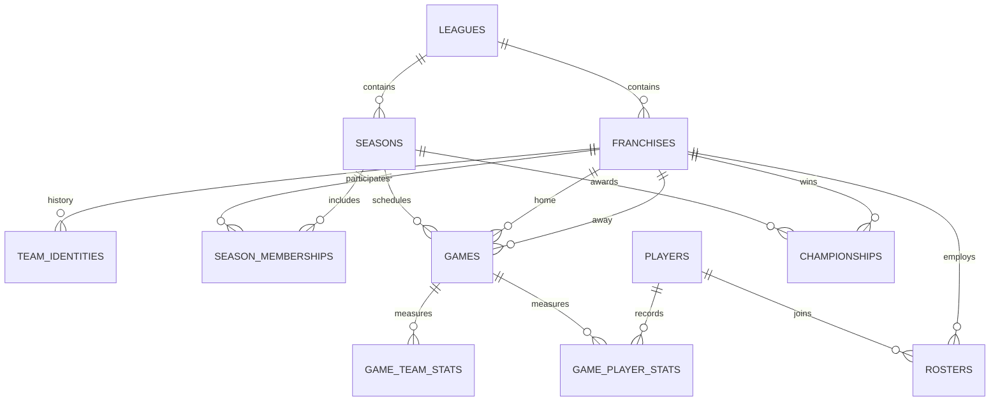

# EndZone — Modelo de dados v0.1
Estado: proposta lógica para revisão, não migration executada. ADR-001; FR-010–015.

## PostgreSQL
UUID PK internos salvo indicação; timestamps timestamptz UTC; temporada NFL integer, datas históricas date e kickoff nullable quando desconhecido. Valores ausentes NULL. FKs indexadas conforme consultas; exclusão de fatos restrita.

| Schema/tabela | Campos principais e restrições |
|---|---|
| sports.leagues | id, code unique, name |
| sports.seasons | id, league_id FK, year, status; unique(league_id,year) |
| sports.franchises | id, league_id FK, stable_code, founded_year; unique(league_id,stable_code) |
| sports.team_identities | id, franchise_id FK, name, abbreviation, city, valid_from, valid_to; intervalos não sobrepostos por franquia |
| sports.conferences | id, league_id FK, code |
| sports.divisions | id, conference_id FK, code |
| sports.season_memberships | season_id, franchise_id, division_id, team_identity_id; PK(season_id,franchise_id); validar mesma franquia e liga |
| sports.stadiums | id, name, city, country, capacity nullable |
| sports.players | id, display_name, birth_date nullable |
| sports.rosters | id, season_id, franchise_id, player_id, position, valid_from, valid_to; intervalos e transferências preservados |
| sports.games | id, season_id, phase, week nullable, game_date, kickoff nullable, status, stadium_id nullable, neutral_site nullable, home_franchise_id, away_franchise_id, home_identity_id, away_identity_id, home_score, away_score, revision; FKs; equipes distintas; scores não negativos, ambos obrigatórios para final publicado; identidade pertence à franquia; fase regular/postseason/super_bowl/preseason |
| sports.game_team_stats | game_id, franchise_id, touchdowns, offensive_yards, passing_yards, rushing_yards, turnovers, sacks, interceptions, revision; PK(game_id,franchise_id); participante válido; métricas nullable e não negativas quando aplicável |
| sports.game_player_stats | game_id, player_id, franchise_id, passing_yards, rushing_yards, receiving_yards, touchdowns, interceptions, sacks, revision; PK(game_id,player_id,franchise_id); jardas podem ser negativas; sacks numeric para frações |
| sports.championships | id, season_id, franchise_id, title_type, scope_key, game_id nullable; unique(season_id,title_type,scope_key); tipos division/conference/super_bowl/league |
| ingestion.providers | id, code unique, license_ref, approved_at, enabled |
| ingestion.external_ids | provider_id, entity_type, external_id, internal_id; PK(provider_id,entity_type,external_id); integridade por tabelas tipadas ou validação transacional |
| ingestion.manifests | id, provider_id, dataset, partition_key, sha256, object_key, byte_count, source_url, fetched_at, schema_version; unique(provider_id,dataset,partition_key,sha256) |
| ingestion.checkpoints | provider_id,dataset,partition_key,stage,cursor,manifest_id,last_success_at; PK(provider_id,dataset,partition_key,stage) |
| ingestion.runs | id, provider_id, dataset, partition_key, status, started_at, finished_at, counts, error_summary |
| ingestion.quarantine | id, manifest_id, source_row_key, reason, status, reviewed_at, reviewer |
| ingestion.fact_revisions | id, entity_type, entity_id, revision, manifest_id, previous_values, approved_at; unique(entity_type,entity_id,revision) |
| ingestion.outbox | id, event_type, entity_id, revision, payload, created_at, processed_at; unique(event_type,entity_id,revision); consumer-specific receipts for multiple consumers |

## Relacionamentos

## Analytics
Start with SQL views/query repository; optional materialized projections after benchmark. game_participants view emits two rows per final validated game, with opponent, points_for/against, outcome W/L/T, venue role, season and disjoint phase. head_to_head_season key (franchise_low,franchise_high,season_id,phase), games, wins_low/high, ties, points_low/high, max scores, revision. team_season key(franchise_id,season_id,phase), counts/sums and observed metric counts. Streaks calculated from chronological eligible games; ties break streak, ambiguous ordering flagged. Do not average averages. Overall and direct modes separate. Titles independent of direct game filters. Coverage derived from manifests and observed records; no claim of complete history without evidence.
Indexes: games(home_franchise_id,away_franchise_id,season_id,phase) and reversed pair, partial final indexes as benchmark warrants; games(season_id,game_date,id); game_team_stats(franchise_id,game_id); game_player_stats(player_id,game_id); roster(player_id,season_id); outbox pending. Consider generated unordered pair columns. Pagination by date/kickoff and id, stable revision. Validate execution plans with realistic volumes.

## MongoDB
Collections franchise_histories, player_biographies, articles, research_proposals. Common document: _id, canonicalEntityId (UUID string), type, locale, title, sections[], sources[{url,retrievedAt,licenseRef,excerpt}], revision, status draft/reviewed/published/rejected, reviewedBy, reviewedAt, updatedAt. Unique(entityId,type,locale,revision) where applicable; articles use stable article ID. Index status/updatedAt and canonicalEntityId. No canonical score storage. Cross-store IDs validated by application, not FK. Publish only approved content and respect rights.

## Object storage
Private bucket, keys raw/{provider}/{dataset}/{partition}/{sha256}.{format}; immutable content, manifests in PostgreSQL, checksum verified on upload/read, compressed CSV/Parquet where source supports. Backups separate prefix/bucket and retention policy; credentials least privilege. No public raw data without license. Orphan reconciliation and verified restore. Never delete canonical facts at season close.

## Rollout
1. Verify provider schemas/rights and sample volumes.
2. Implement migrations for canonical sports and ingestion metadata, retaining existing ingestion.snapshots/checkpoints until explicit migration (new partition checkpoint table name or migration required).
3. Import franchise identities, seasons, games and results first; then players/rosters and detailed stats.
4. Validate fixtures and reconciliation; build comparison queries and benchmark.
5. Activate object storage and migrate raw payloads with checksum/restore verification; MongoDB only when narrative feature needs it.
6. Add projections and agents, API/BFF and UI.
No production provisioning or destructive migration approved here. Exact column types, source mappings, RLS/roles and DDL require implementation review. PostgreSQL private schemas, separate worker/read roles, no direct browser access to ingestion. Track storage and budget before backfill.

## Extensão Benchmarking — FR-016–020
Projeções lógicas LeagueBenchmark, ConferenceBenchmark, DivisionBenchmark, ChampionsBenchmark e HistoricalBenchmark derivadas de game_participants, team_season, season_memberships e championships. Preservar soma e contagem observada por métrica, vitórias/empates/jogos, franquia, temporada, fase e revisão; não armazenar apenas médias. Para referência por conferência/divisão, resolver filiação da franquia alvo e dos pares em cada temporada; se desconhecida, sinalizar cobertura parcial. Campeões: selecionar franquia-temporada com título Super Bowl, excluir alvo. History: comparar períodos explícitos da mesma franquia. Média ponderada = soma dos valores / soma dos jogos observados; peso igual = média das taxas por franquia elegível. Percentual de vitórias = (W+0.5*T)/G. Zero denominador retorna NULL. Ranking usa métrica normalizada, cobertura mínima configurável e empates explícitos. Não requer novos bancos; avaliar materialização por benchmark. Correções e alterações de filiação/títulos invalidam projeções afetadas.
